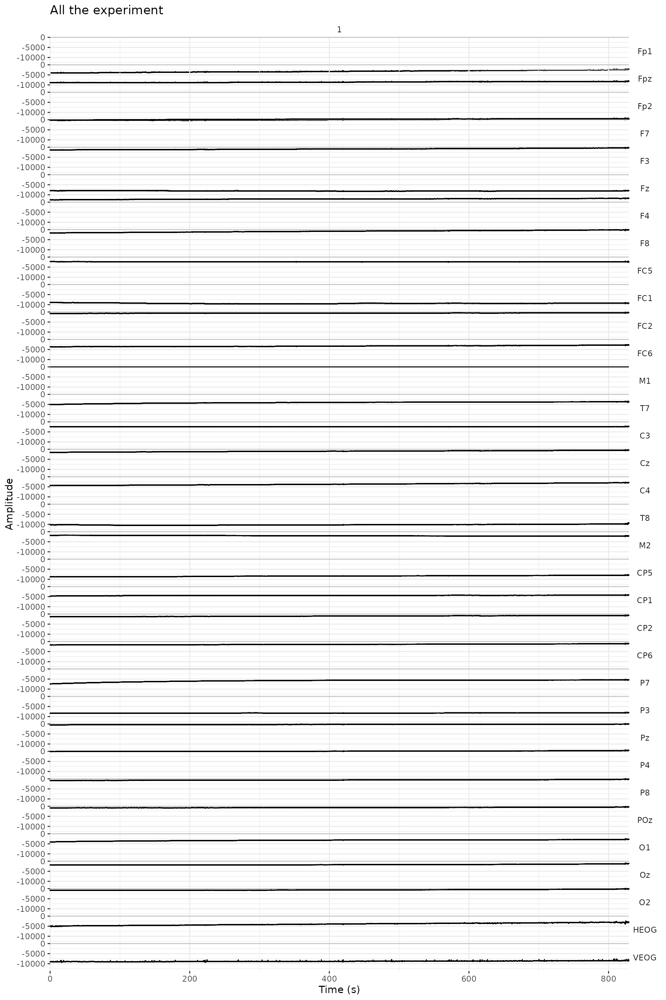
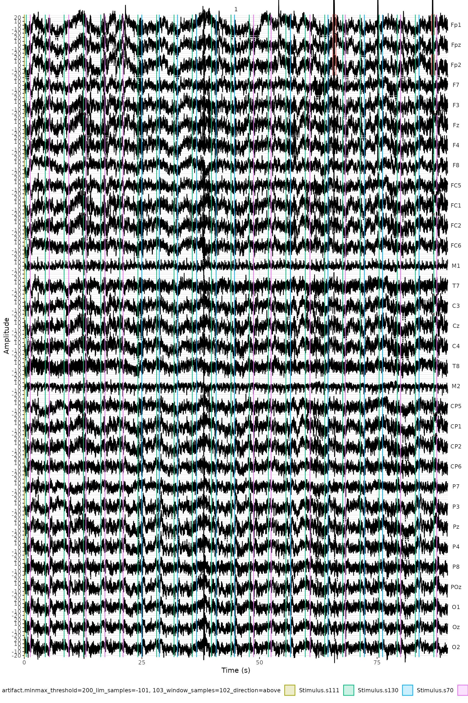
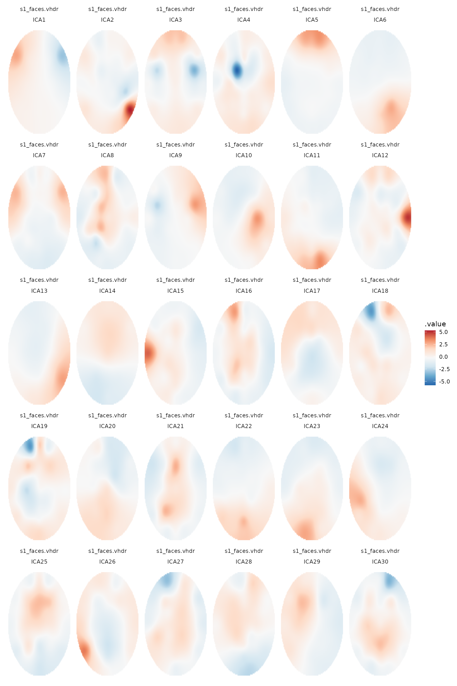
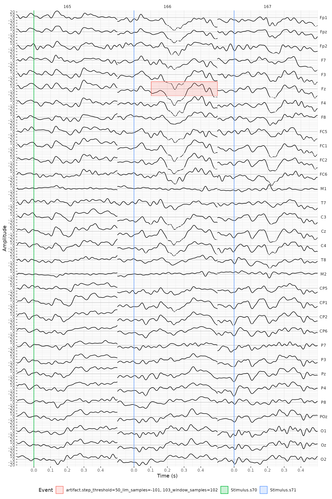
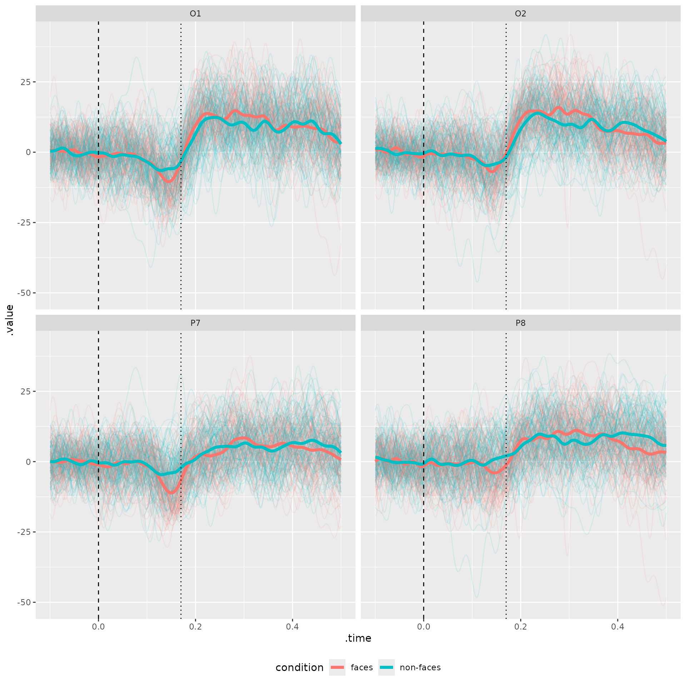
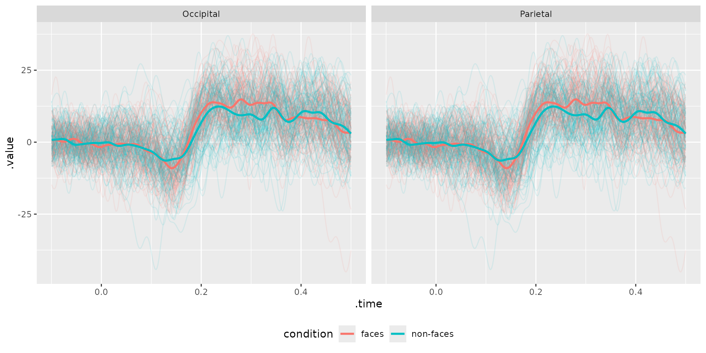
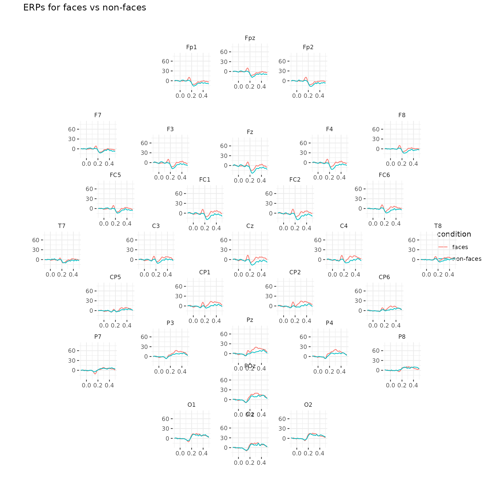
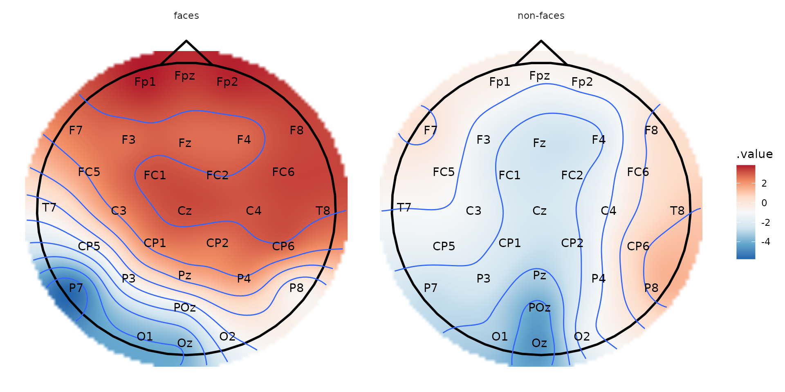
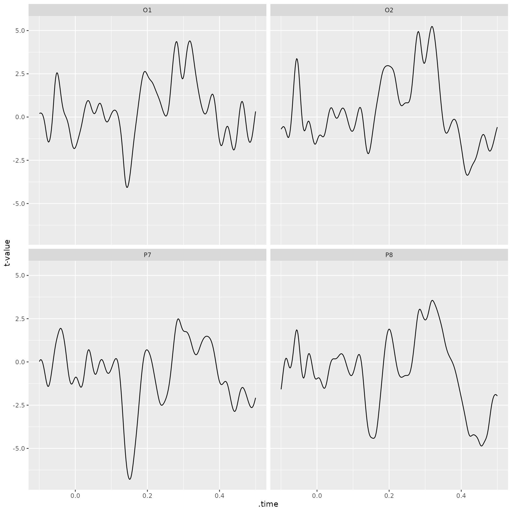
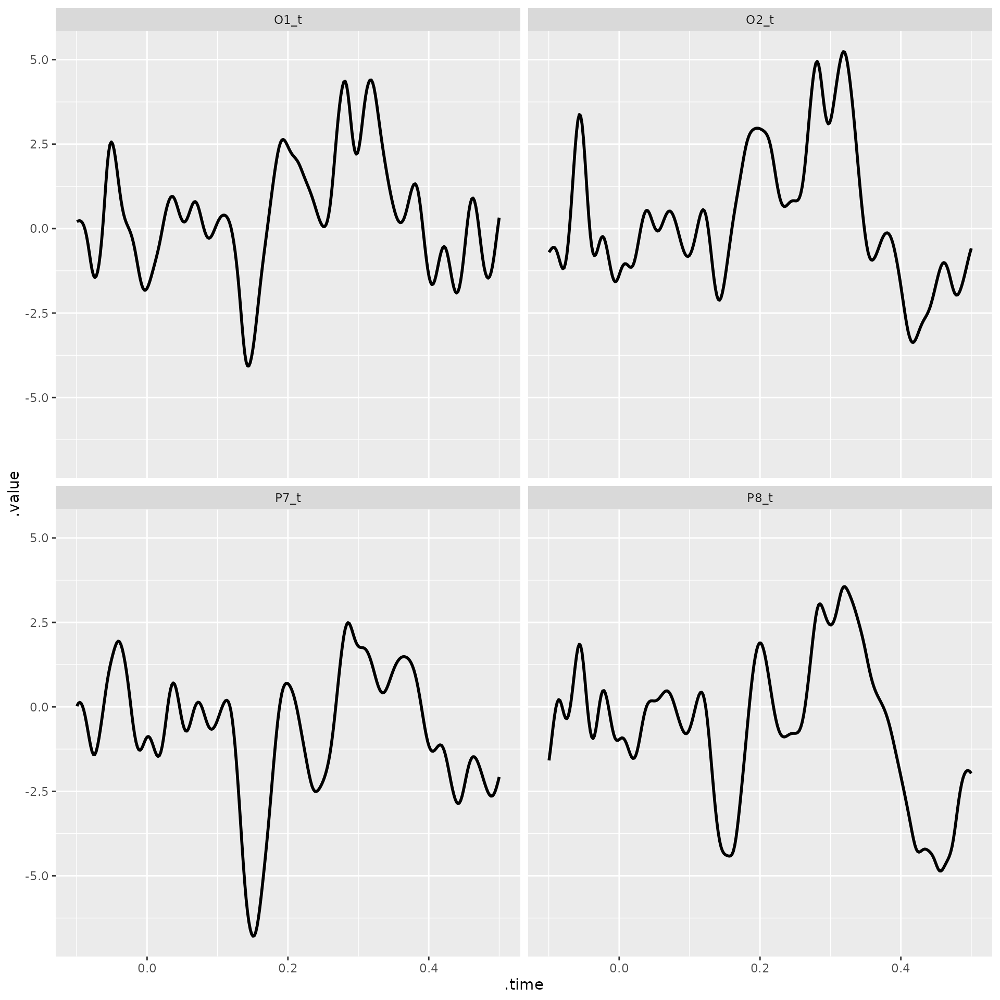

# Introduction - Preprocessing and visualization of EEG data

The package *eeguana* provides a framework for doing simple
pre-processing with specialized functions and manipulating EEG data with
*dplyr* verbs (e.g., `eeg_mutate`, `eeg_filter`, `eeg_summarize`)
extended to a new class `eeg_lst`, and `ggplot` wrapper functions. The
new class is inspired by tidyverse principles but it’s not really “tidy”
(due to space considerations), it’s a list of (i) a wide table that
contains the signal amplitudes at every sample point of the EEG, (ii) an
events table with information about markers (or triggers), blinks and
other exported information, and (iii) a long table with experimental
information, such as participant (`recording`), conditions, etc.

While it’s possible to transform the `eeg_lst` to a `data.frame`,
`data.table` or a `tibble` (with
[`as.data.frame()`](https://rdrr.io/r/base/as.data.frame.html),
`as.data.table()` and `as_tibble()`), the motivation for manipulating
the data in the `eeg_lst` format has to do with size considerations. In
this case, the original file was 113 MB, converting it to a long format
entails a lot of repetition and generates an object of 556 MB. While
this will still work here, a long format quickly becomes prohibitive in
real settings with longer recordings.

Dplyr-like verbs always return an `eeg_lst` object, which allows us to
use `magrittr`’s pipe, `%>%` (see `` ?`dplyr-eeguana` ``) or the
relatively new R pipe `|>`. In addition, `eeg_`/`ch_` functions will
also return an `eeg_lst` unless they have a suffix `_tbl` that indicates
they return a data frame. In general, we will work with the `eeg_lst`,
unless we want to modify the channels information (with
[`channels_tbl()`](https://bruno.nicenboim.me/eeguana/reference/channels_tbl.md))
or the events table containing markers, artifacts ans custom annotations
(with `events_tbl`).

## A practical example: the N170 effect

Here, I exemplify the use of *eeguana* with raw EEG data exported in the
format of BrainVision 1.0. The data belong to a simple experiment where
a participant was presented 100 faces and 100 assorted images in random
order. The task of the experiment was to mentally count the number of
faces.

First we download the data:

``` r

# Run the following or just download the files from raw_faces folder in https://osf.io/tbwvz/
library(httr)
GET("https://osf.io/wv5hp//?action=download",
  write_disk("./s1_faces.vhdr", overwrite = TRUE), 
  progress()
)
GET("https://osf.io/c8wea//?action=download",
  write_disk("./s1_faces.vmrk", overwrite = TRUE), 
  progress()
)
GET("https://osf.io/uhsde//?action=download",
  write_disk("./s1_faces.eeg", overwrite = TRUE), 
  progress()
)
```

BrainVision 1.0 exports three files: `s1_faces.vhdr`, `s1_faces.vmrk`,
and `s1_faces.eeg`. The file `s1_faces.vhdr` contains the metadata and
links to the other two files, `s1_faces.vmrk` contains the triggers and
other events in the samples, and `s1_faces.eeg` contains the signals at
every sample for every channel recorded.

We load the relevant packages first. Here, I use `tidytable` which is a
faster alternative to `dplyr` with a very similar interface.

``` r

library(tidytable) # faster alternative to dplyr
library(ggplot2)
library(eeguana)
set.seed(123) # ICA will always find the same components
```

We first need to read the data:

``` r

faces <- read_vhdr("s1_faces.vhdr")
#> # Reading file s1_faces.vhdr...
#> # Data from ./s1_faces.eeg was read.
#> # Data from 1 segment(s) and 34 channels was loaded.
#> # Object size in memory 113.4 Mb
```

The function
[`read_vhdr()`](https://bruno.nicenboim.me/eeguana/reference/read_vhdr.md)
creates a list with data frames for the signal, events, segments
information, and incorporates in its attributes generic EEG information.

``` r

faces
#> # EEG data:
#> 
#> # Signal table:
#>           .id      .sample           Fp1           Fpz           Fp2            F7
#>         <int> <sample_int> <channel_dbl> <channel_dbl> <channel_dbl> <channel_dbl>
#>      1:     1            1     -17878.56     -8921.395     -14028.81     -284.2541
#>      2:     1            2     -17903.75     -8948.022     -14056.53     -303.9134
#>      3:     1            3     -17916.55     -8961.906     -14070.91     -307.1683
#>      4:     1            4     -17918.17     -8963.691     -14068.63     -299.8859
#>      5:     1            5     -17917.71     -8965.658     -14069.16     -294.7915
#>     ---                                                                           
#> 424484:     1       424484     -16094.71     -8234.730     -13505.21      609.9043
#> 424485:     1       424485     -16140.11     -8280.301     -13547.56      603.1918
#> 424486:     1       424486     -16145.24     -8275.078     -13528.22      541.3096
#> 424487:     1       424487     -16165.22     -8294.479     -13546.50      467.7130
#> 424488:     1       424488     -16167.39     -8305.199     -13561.12      576.3062
#>                    F3            Fz            F4            F8           FC5
#>         <channel_dbl> <channel_dbl> <channel_dbl> <channel_dbl> <channel_dbl>
#>      1:    -1378.1467     -8077.128      1167.489    -1663.4490     -2315.080
#>      2:    -1400.6560     -8101.660      1145.292    -1685.9034     -2338.859
#>      3:    -1407.8466     -8114.331      1138.028    -1691.4203     -2343.475
#>      4:    -1401.9985     -8116.114      1139.702    -1683.0713     -2333.746
#>      5:    -1401.2996     -8119.442      1136.373    -1684.2664     -2326.648
#>     ---                                                                      
#> 424484:     -236.9552     -7991.669      1977.146     -162.8618     -2290.511
#> 424485:     -311.0485     -8045.019      1938.122     -183.0542     -2424.133
#> 424486:     -291.0218     -8032.237      1965.358     -132.3712     -2291.431
#> 424487:     -302.0740     -8052.393      1930.877     -180.4978     -2361.589
#> 424488:     -319.2688     -8065.579      1927.474     -188.0929     -2368.595
#>                   FC1           FC2           FC6            M1            T7
#>         <channel_dbl> <channel_dbl> <channel_dbl> <channel_dbl> <channel_dbl>
#>      1:     -9040.689     -795.0549     -3665.146             0     -5156.998
#>      2:     -9064.137     -816.1298     -3688.133             0     -5184.417
#>      3:     -9071.438     -823.4675     -3690.046             0     -5186.146
#>      4:     -9065.608     -817.9690     -3681.642             0     -5174.358
#>      5:     -9061.397     -817.2882     -3679.563             0     -5170.146
#>     ---                                                                      
#> 424484:     -9349.164     -318.8641     -2805.395             0     -3703.158
#> 424485:     -9410.679     -364.1038     -2833.090             0     -3834.959
#> 424486:     -9379.728     -342.3297     -2811.445             0     -3773.260
#> 424487:     -9381.456     -358.2924     -2868.325             0     -3746.392
#> 424488:     -9409.171     -363.8277     -2853.797             0     -3615.768
#>                    C3            Cz            C4            T8            M2
#>         <channel_dbl> <channel_dbl> <channel_dbl> <channel_dbl> <channel_dbl>
#>      1:     -2466.320    -1568.4097     -4427.577    -10351.511     -1845.363
#>      2:     -2490.411    -1591.3053     -4450.049    -10372.402     -1850.862
#>      3:     -2495.726    -1597.7970     -4454.775    -10378.323     -1845.087
#>      4:     -2487.358    -1591.5627     -4449.590    -10373.983     -1836.370
#>      5:     -2481.878    -1588.5833     -4446.334    -10370.489     -1841.961
#>     ---                                                                      
#> 424484:     -2301.288     -395.4219     -2952.459     -9502.499     -2128.771
#> 424485:     -2372.439     -444.3945     -2994.426     -9465.224     -2179.546
#> 424486:     -2312.064     -419.6414     -2975.410     -9389.198     -2153.340
#> 424487:     -2304.304     -426.3353     -2986.242     -9369.264     -2141.644
#> 424488:     -2358.720     -437.9209     -2984.145     -9521.864     -2130.978
#>                   CP5           CP1           CP2           CP6            P7
#>         <channel_dbl> <channel_dbl> <channel_dbl> <channel_dbl> <channel_dbl>
#>      1:     -8938.128     -4755.838    -1369.6688     -1729.708     -7513.455
#>      2:     -8963.231     -4778.917    -1391.3324     -1750.029     -7535.836
#>      3:     -8969.171     -4784.986    -1397.7506     -1757.532     -7541.739
#>      4:     -8957.989     -4775.938    -1391.9026     -1754.553     -7530.282
#>      5:     -8950.726     -4772.205    -1388.7207     -1755.197     -7524.361
#>     ---                                                                      
#> 424484:     -8037.571     -4200.332     -677.7635     -1046.501     -5433.473
#> 424485:     -8083.840     -4253.405     -721.7708     -1080.431     -5470.565
#> 424486:     -8027.603     -4225.636     -702.5348     -1048.874     -5474.501
#> 424487:     -8046.398     -4230.160     -709.1735     -1040.856     -5488.533
#> 424488:     -8060.742     -4244.541     -712.0606     -1053.931     -5478.491
#>                    P3            Pz            P4            P8           POz
#>         <channel_dbl> <channel_dbl> <channel_dbl> <channel_dbl> <channel_dbl>
#>      1:     -8512.474    -537.63159     -99.10343     -875.6397     -852.6708
#>      2:     -8533.438    -557.97095    -117.14455     -892.3933     -871.1710
#>      3:     -8537.741    -561.55725    -122.82701     -892.9816     -873.9114
#>      4:     -8529.099    -552.78510    -117.75130     -886.6740     -866.0771
#>      5:     -8523.562    -549.19885    -117.82441     -885.3681     -865.5070
#>     ---                                                                      
#> 424484:     -8150.485     -34.94090     496.89807     -182.1897     -304.2810
#> 424485:     -8197.932     -79.35287     458.84891     -229.4153     -345.6953
#> 424486:     -8173.215     -60.83399     476.24600     -226.5095     -342.8815
#> 424487:     -8182.244     -64.40166     471.66693     -247.6580     -343.4331
#> 424488:     -8187.780     -69.53255     475.47369     -247.5108     -350.5685
#>                    O1            Oz            O2          HEOG          VEOG
#>         <channel_dbl> <channel_dbl> <channel_dbl> <channel_dbl> <channel_dbl>
#>      1:     -4117.080     -1950.149     -817.4540     -5006.420     -9116.806
#>      2:     -4136.997     -1965.578     -825.3984     -5027.017     -9133.780
#>      3:     -4138.725     -1965.137     -824.5893     -5037.775     -9138.781
#>      4:     -4126.606     -1957.450     -823.7434     -5033.031     -9134.222
#>      5:     -4127.543     -1967.270     -834.0415     -5031.210     -9139.996
#>     ---                                                                      
#> 424484:     -2730.290     -1170.744      -67.8408     -3137.224     -8591.514
#> 424485:     -2777.571     -1209.235     -104.1242     -3216.466     -8672.283
#> 424486:     -2794.121     -1232.792     -135.4974     -3136.874     -8648.578
#> 424487:     -2790.444     -1224.516     -152.9679     -3105.096     -8658.159
#> 424488:     -2804.640     -1245.077     -186.8792     -3162.988     -8660.311
#> 
#> # Events table:
#>        .id       .type .description     .initial       .final .channel
#>      <int>      <char>       <char> <sample_int> <sample_int>   <char>
#>   1:     1 New Segment                         1            1     <NA>
#>   2:     1    Stimulus         s111        10528        10528     <NA>
#>   3:     1    Stimulus         s130        10742        10742     <NA>
#>   4:     1    Stimulus          s71        11175        11175     <NA>
#>   5:     1    Stimulus         s130        12806        12806     <NA>
#>  ---                                                                  
#> 401:     1    Stimulus         s130       411197       411197     <NA>
#> 402:     1    Stimulus          s71       411469       411469     <NA>
#> 403:     1    Stimulus         s121       412943       412943     <NA>
#> 404:     1    Stimulus         s122       412966       412966     <NA>
#> 405:     1    Stimulus         s102       412989       412989     <NA>
#> 
#> # Segments table:
#>      .id    .recording segment
#>    <int>        <char>   <int>
#> 1:     1 s1_faces.vhdr       1
summary(faces)
#> # EEG data:
#> # Sampling rate: 512 Hz.
#> # Size in memory: 113.4 Mb.
#> # Total duration: 00:13:49.
#> # Summary of segments
#>       .recording n_segments n_incomplete
#>           <char>      <int>        <int>
#> 1: s1_faces.vhdr          1            0
#> # Summary of events
#>          .type .description     n
#>         <char>       <char> <int>
#> 1: New Segment                  1
#> 2:    Stimulus         s102     1
#> 3:    Stimulus         s111     1
#> 4:    Stimulus         s121     1
#> 5:    Stimulus         s122     1
#> 6:    Stimulus         s130   200
#> 7:    Stimulus          s70   100
#> 8:    Stimulus          s71   100
```

A first look at the recording is easiest interactively, with
[`eeg_browse()`](https://bruno.nicenboim.me/eeguana/reference/eeg_browse.md).
It opens a Shiny app (it needs the packages *shiny* and *bslib*) that
shows the signal of all the channels in a window that we move through
the recording, with the events marked on top of the signal. The arrow
keys move the window and zoom the amplitudes in and out, and the panel
on the left sets where the window starts, how long it is, and which
channels are shown. Instead of moving through the recording, the window
can also be placed around events, such as the triggers of the
experiment, and moved from one event to the next.

``` r

eeg_browse(faces)
```

This is how the app looks when it opens, at the beginning of the
recording:


Here the recording is one long segment, so there is nothing to select,
and the app is only for browsing. Once the data are segmented, clicking
a segment in the app selects it, and
[`eeg_browse()`](https://bruno.nicenboim.me/eeguana/reference/eeg_browse.md)
returns the `.id` of the selected segments, which
[`eeg_filter()`](https://bruno.nicenboim.me/eeguana/reference/dplyr_verbs.md)
can then remove or keep. We use it this way below, after segmenting.

We see that there is no electrode positions in the object, but since we
know that the layout was a standard 10/20, we’ll add this layout to the
object, using the dataset `layout_32_1020`. This is required to be able
to create topographic plots.

``` r

channels_tbl(faces)
#>     .channel number .reference resolution       unit radius theta   phi    .x    .y    .z
#>       <char> <char>     <char>      <num>     <char>  <num> <num> <num> <num> <num> <num>
#>  1:      Fp1    Ch1       <NA>          1 microvolts     NA    NA    NA    NA    NA    NA
#>  2:      Fpz    Ch2       <NA>          1 microvolts     NA    NA    NA    NA    NA    NA
#>  3:      Fp2    Ch3       <NA>          1 microvolts     NA    NA    NA    NA    NA    NA
#>  4:       F7    Ch4       <NA>          1 microvolts     NA    NA    NA    NA    NA    NA
#>  5:       F3    Ch5       <NA>          1 microvolts     NA    NA    NA    NA    NA    NA
#>  6:       Fz    Ch6       <NA>          1 microvolts     NA    NA    NA    NA    NA    NA
#>  7:       F4    Ch7       <NA>          1 microvolts     NA    NA    NA    NA    NA    NA
#>  8:       F8    Ch8       <NA>          1 microvolts     NA    NA    NA    NA    NA    NA
#>  9:      FC5    Ch9       <NA>          1 microvolts     NA    NA    NA    NA    NA    NA
#> 10:      FC1   Ch10       <NA>          1 microvolts     NA    NA    NA    NA    NA    NA
#> 11:      FC2   Ch11       <NA>          1 microvolts     NA    NA    NA    NA    NA    NA
#> 12:      FC6   Ch12       <NA>          1 microvolts     NA    NA    NA    NA    NA    NA
#> 13:       M1   Ch13       <NA>          1 microvolts     NA    NA    NA    NA    NA    NA
#> 14:       T7   Ch14       <NA>          1 microvolts     NA    NA    NA    NA    NA    NA
#> 15:       C3   Ch15       <NA>          1 microvolts     NA    NA    NA    NA    NA    NA
#> 16:       Cz   Ch16       <NA>          1 microvolts     NA    NA    NA    NA    NA    NA
#> 17:       C4   Ch17       <NA>          1 microvolts     NA    NA    NA    NA    NA    NA
#> 18:       T8   Ch18       <NA>          1 microvolts     NA    NA    NA    NA    NA    NA
#> 19:       M2   Ch19       <NA>          1 microvolts     NA    NA    NA    NA    NA    NA
#> 20:      CP5   Ch20       <NA>          1 microvolts     NA    NA    NA    NA    NA    NA
#> 21:      CP1   Ch21       <NA>          1 microvolts     NA    NA    NA    NA    NA    NA
#> 22:      CP2   Ch22       <NA>          1 microvolts     NA    NA    NA    NA    NA    NA
#> 23:      CP6   Ch23       <NA>          1 microvolts     NA    NA    NA    NA    NA    NA
#> 24:       P7   Ch24       <NA>          1 microvolts     NA    NA    NA    NA    NA    NA
#> 25:       P3   Ch25       <NA>          1 microvolts     NA    NA    NA    NA    NA    NA
#> 26:       Pz   Ch26       <NA>          1 microvolts     NA    NA    NA    NA    NA    NA
#> 27:       P4   Ch27       <NA>          1 microvolts     NA    NA    NA    NA    NA    NA
#> 28:       P8   Ch28       <NA>          1 microvolts     NA    NA    NA    NA    NA    NA
#> 29:      POz   Ch29       <NA>          1 microvolts     NA    NA    NA    NA    NA    NA
#> 30:       O1   Ch30       <NA>          1 microvolts     NA    NA    NA    NA    NA    NA
#> 31:       Oz   Ch31       <NA>          1 microvolts     NA    NA    NA    NA    NA    NA
#> 32:       O2   Ch32       <NA>          1 microvolts     NA    NA    NA    NA    NA    NA
#> 33:     HEOG   Ch33       <NA>          1 microvolts     NA    NA    NA    NA    NA    NA
#> 34:     VEOG   Ch34       <NA>          1 microvolts     NA    NA    NA    NA    NA    NA
#>     .channel number .reference resolution       unit radius theta   phi    .x    .y    .z
#>       <char> <char>     <char>      <num>     <char>  <num> <num> <num> <num> <num> <num>
## In case the order of the electrodes is different, we do a left_join instead of replacing the table:
channels_tbl(faces) <- select(channels_tbl(faces), .channel) |>
  left_join(layout_32_1020)
```

The plots that **eeguana** produce are `ggplot` objects that can be
modified like regular `ggplot`.

``` r

plot(faces) +
  ggtitle("All the experiment")
#> # Downsampling from 512Hz to 256Hz.
#> # Object size in memory 56.7 Mb
```



## Pre-processing

Here the preprocessing is done with only one EEG dataset. The last
section, [More than one participant](#more-than-one-participant), shows
how to repeat it for the data of several participants and bind them
together.

### Rereferencing

In this dataset, the signal from all electrodes is monopolar and
referenced to the left mastoid (M1). We want the signal (excluding the
EOG channels) to be referenced to linked (left and right) mastoids (M1
and M2).

``` r

faces <- eeg_rereference(faces, -VEOG, -HEOG, .ref = c("M1", "M2"))
```

### Filtering

We apply a band pass filter of 0.1 to 30 Hz to all the channels except
the EOG channels. We don’t segment yet, because discontinuities in the
signal create artifacts on the edges.

``` r

faces_filt <- eeg_filt_band_pass(faces, -HEOG, -VEOG, .freq = c(.1, 30)) 
#> Setting up band-pass filter from 0.1 - 30 Hz
#> Width of the transition band at the low cut-off frequency is 0.1 Hz
#> Width of the transition band at the high cut-off frequency is 7.5 Hz
```

### ICA

We want to apply ICA to as much data as possible, but to
“representative” data: to data of the experiment and not when the
participants were moving or reading the instructions. For the same
reason, we want to the ignore artifacts that we are sure are not
representing brain activity, because of the extreme amplitudes in the
signal.

We first cut a large segment that excludes data before and after the
experiment was ran using
[`eeg_segment()`](https://bruno.nicenboim.me/eeguana/reference/eeg_segment.md)
(that is, only data from the marker “s111” to “s121”), and then we mark
differences of 200 microvolts between peaks with
[`eeg_artif_minmax()`](https://bruno.nicenboim.me/eeguana/reference/eeg_artif.md).

``` r

faces_ls <- eeg_segment(faces_filt, 
                        .description == "s111", 
                        .end = .description == "s121") |>
  eeg_artif_minmax(-HEOG, -VEOG, 
                   .threshold = 200, 
                   .window = 200, 
                   .unit = "ms")
#> # Total of 1 segments found.
#> # Object size in memory 107.5 Mb after segmentation.
#> # Number of intervals with artifacts: 118
```

`eeg_artif_minimax()` only adds the artifacts in the events table and
doesn’t modify the signal. We can have a look at the type of artifacts
that were detected, by plotting the signal and the events with
[`annotate_events()`](https://bruno.nicenboim.me/eeguana/reference/annotate_events.md).
It would be a good idea to just check a couple of seconds of the signal,
for that we use the dplyr-like function
[`eeg_filter()`](https://bruno.nicenboim.me/eeguana/reference/dplyr_verbs.md).

``` r

faces_ls |>
  eeg_select(-HEOG, -VEOG)|>
  eeg_filter(as_time(.sample, .unit = "s") |> between(0, 90)) |>
  plot() +
  annotate_events() +
  theme(legend.position = "bottom")
#> # Downsampling from 512Hz to 256Hz.
#> # Object size in memory 5.9 Mb
```



Now we can run ICA, removing the EOG and reference electrodes, and
ignoring the artifacts.

``` r

## By default, it will ignore artifacts
faces_ica <- faces_ls |>
  eeg_ica(-HEOG, -VEOG, -M1, -M2, .method = adapt_fast_ICA, .ignore = .type == "artifact")
#> # ICA is being done using adapt_fast_ICA...
#> # 97% of the samples will be used.
#> # ICA took 1.26 mins
```

We can now check the different topographic plots of the ICAs with
[`plot_components()`](https://bruno.nicenboim.me/eeguana/reference/plot_components.md),
and their correlation with the EOG channels looking a the summary of the
object.

``` r

faces_ica |> plot_components()
```



``` r

eeg_ica_summary_tbl(faces_ica)
#> EOG channels detected as: HEOG, VEOG
#>        .recording    EOG   .ICA           cor         var
#>            <char> <char> <char>         <num>       <num>
#>  1: s1_faces.vhdr   VEOG   ICA5  0.3110616894 0.334239850
#>  2: s1_faces.vhdr   HEOG   ICA5  0.0060600201 0.334239850
#>  3: s1_faces.vhdr   VEOG  ICA14  0.0594109202 0.084217036
#>  4: s1_faces.vhdr   HEOG  ICA14  0.0115211860 0.084217036
#>  5: s1_faces.vhdr   VEOG  ICA13 -0.0733915975 0.057057041
#>  6: s1_faces.vhdr   HEOG  ICA13  0.0028042746 0.057057041
#>  7: s1_faces.vhdr   VEOG   ICA1  0.0590125612 0.052589289
#>  8: s1_faces.vhdr   HEOG   ICA1 -0.0556782278 0.052589289
#>  9: s1_faces.vhdr   VEOG  ICA25  0.0191137136 0.037790859
#> 10: s1_faces.vhdr   HEOG  ICA25  0.0079409656 0.037790859
#> 11: s1_faces.vhdr   VEOG  ICA22 -0.0729992398 0.036215814
#> 12: s1_faces.vhdr   HEOG  ICA22 -0.0075857794 0.036215814
#> 13: s1_faces.vhdr   VEOG  ICA30 -0.0318988532 0.030671273
#> 14: s1_faces.vhdr   HEOG  ICA30 -0.0049492927 0.030671273
#> 15: s1_faces.vhdr   VEOG  ICA28  0.0215901453 0.030593954
#> 16: s1_faces.vhdr   HEOG  ICA28 -0.0026613292 0.030593954
#> 17: s1_faces.vhdr   VEOG  ICA27 -0.0146958686 0.029824133
#> 18: s1_faces.vhdr   HEOG  ICA27 -0.0005737728 0.029824133
#> 19: s1_faces.vhdr   HEOG  ICA26 -0.0127623329 0.026000815
#> 20: s1_faces.vhdr   VEOG  ICA26 -0.0103929696 0.026000815
#> 21: s1_faces.vhdr   VEOG  ICA21 -0.0110379588 0.024648945
#> 22: s1_faces.vhdr   HEOG  ICA21  0.0041385932 0.024648945
#> 23: s1_faces.vhdr   VEOG  ICA16  0.0189808192 0.024065801
#> 24: s1_faces.vhdr   HEOG  ICA16 -0.0052139432 0.024065801
#> 25: s1_faces.vhdr   VEOG   ICA6 -0.0089105463 0.022756936
#> 26: s1_faces.vhdr   HEOG   ICA6  0.0049753303 0.022756936
#> 27: s1_faces.vhdr   HEOG  ICA17 -0.0091874914 0.022147912
#> 28: s1_faces.vhdr   VEOG  ICA17  0.0017426840 0.022147912
#> 29: s1_faces.vhdr   VEOG  ICA23 -0.0139531104 0.021567157
#> 30: s1_faces.vhdr   HEOG  ICA23  0.0080386572 0.021567157
#> 31: s1_faces.vhdr   VEOG  ICA24 -0.0121801971 0.019263447
#> 32: s1_faces.vhdr   HEOG  ICA24 -0.0016042248 0.019263447
#> 33: s1_faces.vhdr   VEOG  ICA10  0.0029772146 0.018948088
#> 34: s1_faces.vhdr   HEOG  ICA10 -0.0012705350 0.018948088
#> 35: s1_faces.vhdr   HEOG  ICA29 -0.0098960226 0.016990873
#> 36: s1_faces.vhdr   VEOG  ICA29  0.0082034132 0.016990873
#> 37: s1_faces.vhdr   HEOG   ICA7 -0.0020891334 0.016963604
#> 38: s1_faces.vhdr   VEOG   ICA7 -0.0003910153 0.016963604
#> 39: s1_faces.vhdr   VEOG   ICA8 -0.0061078333 0.012798386
#> 40: s1_faces.vhdr   HEOG   ICA8 -0.0033160702 0.012798386
#> 41: s1_faces.vhdr   VEOG  ICA19 -0.0113037545 0.012625051
#> 42: s1_faces.vhdr   HEOG  ICA19  0.0040990970 0.012625051
#> 43: s1_faces.vhdr   HEOG  ICA11 -0.0080689883 0.011544475
#> 44: s1_faces.vhdr   VEOG  ICA11 -0.0022034332 0.011544475
#> 45: s1_faces.vhdr   VEOG  ICA20 -0.0062150226 0.007460283
#> 46: s1_faces.vhdr   HEOG  ICA20 -0.0011994425 0.007460283
#> 47: s1_faces.vhdr   VEOG   ICA2 -0.0126428949 0.007089662
#> 48: s1_faces.vhdr   HEOG   ICA2 -0.0078820112 0.007089662
#> 49: s1_faces.vhdr   VEOG   ICA3  0.0866623859 0.006302069
#> 50: s1_faces.vhdr   HEOG   ICA3 -0.0019740756 0.006302069
#> 51: s1_faces.vhdr   HEOG   ICA9 -0.0019097967 0.006254332
#> 52: s1_faces.vhdr   VEOG   ICA9  0.0015343447 0.006254332
#> 53: s1_faces.vhdr   VEOG  ICA15 -0.0265727074 0.005244650
#> 54: s1_faces.vhdr   HEOG  ICA15 -0.0041488999 0.005244650
#> 55: s1_faces.vhdr   VEOG  ICA18 -0.0131764353 0.005012006
#> 56: s1_faces.vhdr   HEOG  ICA18 -0.0117696565 0.005012006
#> 57: s1_faces.vhdr   HEOG   ICA4 -0.0190202998 0.004207052
#> 58: s1_faces.vhdr   VEOG   ICA4 -0.0171506626 0.004207052
#> 59: s1_faces.vhdr   VEOG  ICA12  0.0144307012 0.004146247
#> 60: s1_faces.vhdr   HEOG  ICA12  0.0128083915 0.004146247
#>        .recording    EOG   .ICA           cor         var
#>            <char> <char> <char>         <num>       <num>
```

We’ll look closer at the ICA that are more likely to be related to eye
movements, and we’ll compare with signals that look like blinks and
saccades:

``` r

faces_ica <- faces_ica |>
  eeg_artif_step(HEOG, VEOG, 
                 .threshold = 30, 
                 .window = 200, 
                 .unit = "ms", 
                 .freq = c(1, 10)) |>
  eeg_artif_peak(VEOG, .threshold = 100, .freq = c(1, 10))
#> Setting up band-pass filter from 1 - 10 Hz
#> Width of the transition band at the low cut-off frequency is 1 Hz
#> Width of the transition band at the high cut-off frequency is 2.5 Hz
#> # Number of intervals with artifacts: 407
#> Setting up band-pass filter from 1 - 10 Hz
#> Width of the transition band at the low cut-off frequency is 1 Hz
#> Width of the transition band at the high cut-off frequency is 2.5 Hz
#> # Number of intervals with artifacts: 160
```

The easiest way to investigate the ICA is interactively, with
[`eeg_browse()`](https://bruno.nicenboim.me/eeguana/reference/eeg_browse.md).
For an ICA, it opens a Shiny app that shows the activations of the
components next to the EOG channels, and their topographies, labeled
with the variance they explain and their correlation with the EOG
channels. The window can be placed around events, such as the blinks we
just marked, and moved from one blink to the next, or moved through the
recording. Clicking a topography selects the component, and when we are
done, the app returns the selected components, one vector of names for
each recording. Here, we select the components that we want to remove:

``` r

to_remove <- eeg_browse(faces_ica)
```

This is how the app looks around the first blink, after clicking the
topography of ICA5 to select it:


ICA5 is the clearest one: it explains a third of the variance and
correlates 0.91 with the VEOG channel. So it’s the only one we selected,
and the only one we remove:

``` r

to_remove
#> $s1_faces.vhdr
#> [1] "ICA5"
faces_icaed <- faces_ica |>
  eeg_ica_keep(-all_of(to_remove[[1]])) |>
  as_eeg_lst()
```

Now we’ll segment the data to appropriate check if there are still
artifacts.

``` r

events_tbl(faces_icaed) <- events_tbl(faces_icaed) |>
  filter(!.type %in% "artifact")

faces_seg <- faces_icaed |>
  eeg_select(-description, -type) |>
  eeg_segment(.description %in% c("s70", "s71"), .lim = c(-.1, .5))
#> # Total of 200 segments found.
#> # Object size in memory 16.5 Mb after segmentation.

faces_seg_artif <- faces_seg |>
  eeg_artif_minmax(-HEOG, -VEOG, .threshold = 100, .window = 150, .unit = "ms") |>
  eeg_artif_step(-HEOG, -VEOG, .threshold = 50, .window = 200, .unit = "ms")
#> # Number of intervals with artifacts: 0
#> # Number of intervals with artifacts: 1

## extracts the ids of the segments with artifacts
bad <- filter(events_tbl(faces_seg_artif), .type == "artifact") |> 
  pull(.id) |> 
  unique()
## Show the segment with artifact and one before and after:
faces_seg_artif |>
  eeg_filter(.id %in% c(bad-1, bad, bad+1)) |>
  eeg_select(-VEOG, -HEOG) |>
  plot() +
  annotate_events() +
  theme(legend.position = "bottom")
```



The segments can also be inspected interactively with
[`eeg_browse()`](https://bruno.nicenboim.me/eeguana/reference/eeg_browse.md).
For an `eeg_lst`, it shows the signal of the channels through the
recording, with each segment in its own column, or around events, such
as the artifacts, and the topography of the window, one for each
segment. Clicking a segment selects it, and when we are done, the app
returns the `.id` of the selected segments. Here, we would select the
segments we want to remove, and then remove them with
[`eeg_filter()`](https://bruno.nicenboim.me/eeguana/reference/dplyr_verbs.md):

``` r

to_remove <- eeg_browse(faces_seg_artif)
faces_seg_artif <- faces_seg_artif |>
  eeg_filter(!.id %in% to_remove)
```

Here, we remove all the segments with artifacts, by converting their
samples to `NA`:

``` r

faces_seg <- faces_seg_artif |>
  eeg_events_to_NA(.type == "artifact", .entire_seg = TRUE, .drop_events = TRUE)

summary(faces_seg)
#> # EEG data:
#> # Sampling rate: 512 Hz.
#> # Size in memory: 16.5 Mb.
#> # Total duration: 00:02:00.
#> # Summary of segments
#>       .recording n_segments n_incomplete
#>           <char>      <int>        <int>
#> 1: s1_faces.vhdr        200            1
#> # Summary of events
#>       .type .description     n
#>      <char>       <char> <int>
#> 1: Stimulus          s70   100
#> 2: Stimulus          s71   100
```

Finally, we can baseline the segments:

``` r

faces_seg <- faces_seg |> 
  eeg_baseline()
```

## Visualization

We edit the segmentation information and add more descriptive labels.

``` r

faces_seg <- faces_seg |>
  eeg_mutate(
    condition =
      ifelse(description == "s70", "faces", "non-faces")
  ) |>
  eeg_select(-type)

faces_seg
#> # EEG data:
#> 
#> # Signal table:
#>          .id      .sample           Fp1           Fpz           Fp2            F7
#>        <int> <sample_int> <channel_dbl> <channel_dbl> <channel_dbl> <channel_dbl>
#>     1:     1          -50    -0.2239737      2.926696     0.1088197    -0.1107286
#>     2:     1          -49     0.9975430      3.910457     0.7585352     0.7172289
#>     3:     1          -48     2.2477072      4.853125     1.5129425     1.7686192
#>     4:     1          -47     3.3361201      5.596977     2.2208750     2.9135916
#>     5:     1          -46     4.0950011      6.007830     2.7411833     4.0297893
#>    ---                                                                           
#> 61596:   200          253    -7.4272958     -4.030794    -3.3414518     2.5704919
#> 61597:   200          254    -7.0028675     -4.076854    -3.7139526     1.3456003
#> 61598:   200          255    -6.3948136     -4.124318    -4.0795149     0.2178476
#> 61599:   200          256    -5.7744059     -4.236721    -4.4670174    -0.8343465
#> 61600:   200          257    -5.3225204     -4.474952    -4.9176401    -1.8464510
#>                   F3            Fz            F4            F8           FC5
#>        <channel_dbl> <channel_dbl> <channel_dbl> <channel_dbl> <channel_dbl>
#>     1:      3.793132      4.228278      2.840110   -3.15472635     1.6113910
#>     2:      4.038747      4.270218      2.382479   -2.35472265     2.0405680
#>     3:      4.340948      4.421612      2.013301   -1.24644410     2.4513040
#>     4:      4.642705      4.591250      1.709526    0.05225002     2.8087541
#>     5:      4.899710      4.700407      1.452931    1.40978255     3.1051410
#>    ---                                                                      
#> 61596:      4.188729     -8.730353    -12.167556   -1.36556543     4.6994268
#> 61597:      3.356811     -9.453131    -11.842863   -2.17206941     3.4988400
#> 61598:      2.644884     -9.985577    -11.460650   -2.78238153     2.2688876
#> 61599:      1.996052    -10.366157    -11.047480   -3.20156158     1.0080235
#> 61600:      1.323714    -10.661645    -10.644149   -3.46204537    -0.3005228
#>                  FC1           FC2           FC6            M1            T7
#>        <channel_dbl> <channel_dbl> <channel_dbl> <channel_dbl> <channel_dbl>
#>     1:      1.592771     -2.364200    -1.8391090     -2.030141      8.787014
#>     2:      1.860704     -2.861841    -1.1455898     -1.922150      9.114149
#>     3:      2.219617     -3.123105    -0.1976263     -1.785010      8.977623
#>     4:      2.615841     -3.167049     0.8983126     -1.654058      8.398226
#>     5:      3.005053     -3.015121     2.0401272     -1.545839      7.452935
#>    ---                                                                      
#> 61596:     -3.708406    -19.005953   -12.4167239      4.310870      4.908478
#> 61597:     -4.958880    -19.459708   -13.3369315      4.454409      4.680512
#> 61598:     -6.309382    -19.836152   -14.2119912      4.482182      4.315460
#> 61599:     -7.730844    -20.137723   -14.9925296      4.394789      3.730447
#> 61600:     -9.204715    -20.380105   -15.6416067      4.203761      2.864558
#>                   C3            Cz            C4            T8            M2
#>        <channel_dbl> <channel_dbl> <channel_dbl> <channel_dbl> <channel_dbl>
#>     1:    -2.0086889     -5.711339     -0.795271      3.910053      2.030141
#>     2:    -2.1197829     -5.858017     -1.282006      5.477720      1.922150
#>     3:    -2.2059909     -5.721134     -1.762303      7.069972      1.785010
#>     4:    -2.2445165     -5.330143     -2.204568      8.401729      1.654058
#>     5:    -2.1993214     -4.723109     -2.557211      9.193991      1.545839
#>    ---                                                                      
#> 61596:    -0.5437559    -14.854063    -34.752050    -25.822482     -4.310870
#> 61597:    -2.1197706    -16.258766    -35.506742    -27.019577     -4.454409
#> 61598:    -3.8504649    -17.808367    -36.200622    -27.809796     -4.482182
#> 61599:    -5.6655686    -19.413279    -36.808126    -28.198220     -4.394789
#> 61600:    -7.5086186    -20.985826    -37.301315    -28.211914     -4.203761
#>                  CP5           CP1           CP2           CP6            P7
#>        <channel_dbl> <channel_dbl> <channel_dbl> <channel_dbl> <channel_dbl>
#>     1:     2.1730493     -5.558311     -3.912675     2.0442154    -1.8486407
#>     2:     1.6874719     -5.681516     -4.454747     1.4513845    -2.6139953
#>     3:     1.0244766     -5.664134     -4.852158     0.8377522    -3.1638517
#>     4:     0.2760940     -5.506764     -5.089553     0.2248167    -3.4395628
#>     5:    -0.4454964     -5.204630     -5.150715    -0.3509800    -3.4148548
#>    ---                                                                      
#> 61596:     3.4352795     -5.102525    -31.824672   -29.5344073     2.7192767
#> 61597:     2.4188361     -6.646814    -33.109751   -30.5440118     2.3539444
#> 61598:     1.1739532     -8.403855    -34.341884   -31.5585170     1.6063736
#> 61599:    -0.2539754    -10.263130    -35.433438   -32.5685325     0.5699239
#> 61600:    -1.8208137    -12.116925    -36.299732   -33.5345508    -0.6454750
#>                   P3            Pz            P4            P8           POz
#>        <channel_dbl> <channel_dbl> <channel_dbl> <channel_dbl> <channel_dbl>
#>     1:    -2.6437673     -3.191924    -0.6720984     0.5889623     -1.233383
#>     2:    -3.1920017     -3.790144    -1.4646696    -1.8056977     -2.397317
#>     3:    -3.6552420     -4.342437    -2.1770814    -4.0661883     -3.500260
#>     4:    -3.9730269     -4.813028    -2.7552677    -5.9136674     -4.440224
#>     5:    -4.0892851     -5.160562    -3.1471226    -7.1129100     -5.124399
#>    ---                                                                      
#> 61596:     2.7365646    -12.488676   -27.5485924   -23.0238529     -5.742807
#> 61597:     1.6113645    -13.716290   -28.1890858   -22.9764754     -6.553364
#> 61598:     0.2901116    -14.977399   -28.6721202   -22.1172213     -7.394155
#> 61599:    -1.1512356    -16.183334   -28.9837949   -20.4604781     -8.207270
#> 61600:    -2.6374742    -17.250028   -29.1134647   -18.1089704     -8.943773
#>                   O1            Oz            O2          HEOG          VEOG
#>        <channel_dbl> <channel_dbl> <channel_dbl> <channel_dbl> <channel_dbl>
#>     1:    -3.5386535    -0.7969323     0.8721568     -8.172153     -4.070868
#>     2:    -4.7377453    -2.2782486    -0.7106985    -15.399203    -10.286688
#>     3:    -5.8496010    -3.7413040    -2.2901256    -17.091586     -4.218329
#>     4:    -6.7658792    -5.0345596    -3.6833116    -22.001254     -2.728094
#>     5:    -7.3928468    -6.0157379    -4.7178515    -14.368930      3.892999
#>    ---                                                                      
#> 61596:     2.5152642    -3.0701651    -5.1484950     40.897595    104.275391
#> 61597:     1.8963234    -3.5788828    -3.8985745     19.307751     67.568359
#> 61598:     1.0904936    -4.1790541    -2.9052267     24.585583     66.189453
#> 61599:     0.2077071    -4.8230480    -2.2435981      4.779675     43.698242
#> 61600:    -0.6593847    -5.4755758    -1.9725447     -2.815540     36.453125
#> 
#> # Events table:
#>        .id    .type .description     .initial       .final .channel
#>      <int>   <char>       <char> <sample_int> <sample_int>   <char>
#>   1:     1 Stimulus          s71            1            1     <NA>
#>   2:     2 Stimulus          s71            1            1     <NA>
#>   3:     3 Stimulus          s71            1            1     <NA>
#>   4:     4 Stimulus          s71            1            1     <NA>
#>   5:     5 Stimulus          s71            1            1     <NA>
#>  ---                                                               
#> 196:   196 Stimulus          s71            1            1     <NA>
#> 197:   197 Stimulus          s70            1            1     <NA>
#> 198:   198 Stimulus          s71            1            1     <NA>
#> 199:   199 Stimulus          s71            1            1     <NA>
#> 200:   200 Stimulus          s71            1            1     <NA>
#> 
#> # Segments table:
#>        .id    .recording segment description condition
#>      <int>        <char>   <int>      <char>    <char>
#>   1:     1 s1_faces.vhdr       1         s71 non-faces
#>   2:     2 s1_faces.vhdr       2         s71 non-faces
#>   3:     3 s1_faces.vhdr       3         s71 non-faces
#>   4:     4 s1_faces.vhdr       4         s71 non-faces
#>   5:     5 s1_faces.vhdr       5         s71 non-faces
#>  ---                                                  
#> 196:   196 s1_faces.vhdr     196         s71 non-faces
#> 197:   197 s1_faces.vhdr     197         s70     faces
#> 198:   198 s1_faces.vhdr     198         s71 non-faces
#> 199:   199 s1_faces.vhdr     199         s71 non-faces
#> 200:   200 s1_faces.vhdr     200         s71 non-faces
```

With some `ggplot` skills, we can create customized plots. `ggplot` is
overloaded to work on an `eeg_lst` by first downsampling the signal when
necessary, and converting it to a long-format data frame that is feed
into `ggplot`. This object can then be customized. (Notice that the
channels, or component names are in a `.key` column and their amplitude
in `.value` column, and instead of samples there are now `.time` in
seconds).

``` r

## ggplot uses internally a table that looks like this:
faces_seg |> eeg_filter(.id %in% 1:3) |>
  as.data.frame() |> head()
#>         .time .id .key     .value    .recording segment description condition
#> 1 -0.09960938   1  Fp1 -0.2239737 s1_faces.vhdr       1         s71 non-faces
#> 2 -0.09765625   1  Fp1  0.9975430 s1_faces.vhdr       1         s71 non-faces
#> 3 -0.09570312   1  Fp1  2.2477072 s1_faces.vhdr       1         s71 non-faces
#> 4 -0.09375000   1  Fp1  3.3361201 s1_faces.vhdr       1         s71 non-faces
#> 5 -0.09179688   1  Fp1  4.0950011 s1_faces.vhdr       1         s71 non-faces
#> 6 -0.08984375   1  Fp1  4.4007441 s1_faces.vhdr       1         s71 non-faces

faces_seg |>
  eeg_select(O1, O2, P7, P8) |>
  ggplot(aes(x = .time, y = .value)) +
  geom_line(alpha = .1, aes(group = .id, color = condition)) +
  stat_summary(
    fun = "mean", geom = "line", alpha = 1, size = 1.5,
    aes(color = condition)
  ) +
  facet_wrap(~.key) +
  geom_vline(xintercept = 0, linetype = "dashed") +
  geom_vline(xintercept = .17, linetype = "dotted") +
  theme(legend.position = "bottom")
#> Warning: Using `size` aesthetic for lines was deprecated in ggplot2 3.4.0.
#> ℹ Please use `linewidth` instead.
#> This warning is displayed once per session.
#> Call `lifecycle::last_lifecycle_warnings()` to see where this warning was generated.
```



We can see here the N170 component in the faces condition for the
average trial on a single participant. We can investigate the signal by
averaging the channels of the occipital and parietal lobes using
[`transmute()`](https://markfairbanks.github.io/tidytable/reference/transmute.html),
and the special function,
[`chs_mean()`](https://bruno.nicenboim.me/eeguana/reference/chs_mean.md),
a wrapper for [`rowMeans()`](https://rdrr.io/r/base/colSums.html), which
takes as arguments the relevant channels and whether missing values
should be omitted from the calculations.

``` r

faces_seg |>
  eeg_transmute(
    Occipital = chs_mean(across(starts_with("O")), na.rm = TRUE), #O1, O2, Oz
    Parietal = chs_mean(across(starts_with("O")), na.rm = TRUE) # P3, P4, P7, P8, Pz
  ) |>
  ggplot(aes(x = .time, y = .value)) +
  geom_line(alpha = .1, aes(group = .id, color = condition)) +
  stat_summary(
    fun = "mean", geom = "line", alpha = 1, size = 1,
    aes(color = condition)
  ) +
  facet_wrap(~.key) +
  theme(legend.position = "bottom")
```



We can also calculate the ERPs and then plot them in their layout (and
we’ll add the same theme that plot uses for `eeg_lst`s):

``` r

ERP_faces <- faces_seg |>
  eeg_group_by(.sample, condition) |>
  eeg_summarize(across_ch(mean, na.rm = TRUE))
  
ERP_plot <- ERP_faces |>
  ggplot(aes(x = .time, y = .value)) +
  geom_line(aes(color = condition)) +
  facet_wrap(~.key) +
  theme(legend.position = "bottom") +
  ggtitle("ERPs for faces vs non-faces") +
  theme_eeguana()

ERP_plot |> plot_in_layout()
#> Warning: `aes_()` was deprecated in ggplot2 3.0.0.
#> ℹ Please use tidy evaluation idioms with `aes()`
#> ℹ The deprecated feature was likely used in the eeguana package.
#>   Please report the issue at <https://github.com/bnicenboim/eeguana/issues>.
#> This warning is displayed once per session.
#> Call `lifecycle::last_lifecycle_warnings()` to see where this warning was generated.
```



Another possibility is to create a topographic plot of the two
conditions, by first making segments that include only the interval
.1-.2 *s* after the onset of the stimuli, creating a table with
interpolated amplitudes and using the ggplot wrapper
[`plot_topo()`](https://bruno.nicenboim.me/eeguana/reference/plot_topo.md).

``` r

faces_seg |>
  eeg_filter(between(as_time(.sample, .unit = "s"), .1, .2)) |>
  eeg_group_by(condition) |>
  eeg_summarize(across_ch(mean, na.rm = TRUE)) |>
  plot_topo() +
  annotate_head() +
  geom_contour() +
  annotate_electrodes(colour = "black") +
  facet_grid(~condition)
```



For more specialized plots or analyses, it might be necessary to extract
the data in long data frame format first. Even though, we can do this
without transforming the object, here, we transform the data first and
then we visualize independent t-tests at every electrode and time point.

``` r

df <- faces_seg |>
  eeg_select(O1, O2, P7, P8) |>
  as_tidytable() |> #or alternatively as_tibble() if one uses dplyr
  # We can use regular dplyr/tidytable functions now
  group_by(.key, .time) |>
  summarize(
    `t-value` = t.test(
      .value[condition == "faces"],
      .value[condition == "non-faces"]
    )$statistic
  )

df
#> # A tidytable: 1,232 × 3
#> # Groups:      .key
#>    .key    .time `t-value`
#>    <chr>   <dbl>     <dbl>
#>  1 O1    -0.0996    0.204 
#>  2 O1    -0.0977    0.227 
#>  3 O1    -0.0957    0.234 
#>  4 O1    -0.0938    0.219 
#>  5 O1    -0.0918    0.173 
#>  6 O1    -0.0898    0.0880
#>  7 O1    -0.0879   -0.0415
#>  8 O1    -0.0859   -0.221 
#>  9 O1    -0.0840   -0.448 
#> 10 O1    -0.0820   -0.713 
#> # ℹ 1,222 more rows
```

Then we just load the data frame into `ggplot`.

``` r

ggplot(df, aes(x = .time, y = `t-value`)) + geom_line() +
  facet_wrap(~.key)
```



However, this can be also done in the without transforming the `eeg_lst`
object:

``` r

faces_seg_t <-
  faces_seg |>
  eeg_select(O1, O2, P7, P8) |>
  eeg_group_by(.sample) |>
  eeg_summarize(across_ch(list(t =  ~t.test(
    .[condition == "faces"],
    .[condition == "non-faces"]
  )$statistic)))

faces_seg_t |>
  ggplot(aes(x = .time, y = .value)) +
  geom_line(alpha = .1, aes(group = .id)) +
  stat_summary(fun = "mean", geom = "line", alpha = 1, size = 1) +
  facet_wrap(~.key) +
  theme(legend.position = "bottom")
```



## More than one participant

The continuous recording of a single participant is already large (the
file of this one is 113 MB), so keeping the recordings of all the
participants in memory at the same time quickly becomes impossible. A
better strategy is to preprocess each participant on their own, keep
only what the analysis needs (usually the segments around the relevant
events, and maybe fewer channels or a lower sampling rate), save that
small object, and bind the objects of all the participants at the end.

Since choosing the ICA components to remove needs someone to look at
them, the preprocessing goes over the files three times. First, we run
everything up to the ICA for every file, and save the result, because
the ICA takes a while:

``` r

files <- list.files(pattern = "\\.vhdr$") # "s1_faces.vhdr", "s2_faces.vhdr", ...
rds_name <- function(dir, file) file.path(dir, sub("\\.vhdr$", ".rds", file))

prepare_ica <- function(file) {
  eeg <- read_vhdr(file)
  channels_tbl(eeg) <- select(channels_tbl(eeg), .channel) |>
    left_join(layout_32_1020)
  eeg |>
    eeg_rereference(-VEOG, -HEOG, .ref = c("M1", "M2")) |>
    eeg_filt_band_pass(-HEOG, -VEOG, .freq = c(.1, 30)) |>
    eeg_segment(.description == "s111", .end = .description == "s121") |>
    eeg_artif_minmax(-HEOG, -VEOG, .threshold = 200, .window = 200, .unit = "ms") |>
    eeg_ica(-HEOG, -VEOG, -M1, -M2, .method = adapt_fast_ICA, .ignore = .type == "artifact") |>
    eeg_artif_step(HEOG, VEOG, .threshold = 30, .window = 200, .unit = "ms", .freq = c(1, 10)) |>
    eeg_artif_peak(VEOG, .threshold = 100, .freq = c(1, 10))
}

dir.create("ica")
for (file in files) {
  saveRDS(prepare_ica(file), rds_name("ica", file))
}
```

Second, we look at the components of each participant with
[`eeg_browse()`](https://bruno.nicenboim.me/eeguana/reference/eeg_browse.md),
and keep the ones we select for removal. Saving them also documents the
decisions:

``` r

to_remove <- list()
for (file in files) {
  to_remove[[file]] <- eeg_browse(readRDS(rds_name("ica", file)))[[1]]
}
saveRDS(to_remove, "to_remove.rds")
```

Third, we remove the components, segment the data, reject the segments
with artifacts, and baseline them, as we did above for one participant,
and save only the segments:

``` r

segment_clean <- function(file, to_remove) {
  eeg <- readRDS(rds_name("ica", file)) |>
    eeg_ica_keep(-all_of(to_remove)) |>
    as_eeg_lst()
  events_tbl(eeg) <- events_tbl(eeg) |>
    filter(!.type %in% "artifact")
  eeg |>
    eeg_select(-description, -type) |>
    eeg_segment(.description %in% c("s70", "s71"), .lim = c(-.1, .5)) |>
    eeg_artif_minmax(-HEOG, -VEOG, .threshold = 100, .window = 150, .unit = "ms") |>
    eeg_artif_step(-HEOG, -VEOG, .threshold = 50, .window = 200, .unit = "ms") |>
    eeg_events_to_NA(.type == "artifact", .entire_seg = TRUE, .drop_events = TRUE) |>
    eeg_baseline() |>
    eeg_mutate(condition = ifelse(description == "s70", "faces", "non-faces")) |>
    eeg_select(-type)
  ## To make the objects even smaller, one could also keep only some channels
  ## with eeg_select(), or halve the sampling rate with eeg_downsample(.q = 2).
}

dir.create("segments")
for (file in files) {
  saveRDS(segment_clean(file, to_remove[[file]]), rds_name("segments", file))
}
```

Finally, we read the segments of all the participants and bind them into
one `eeg_lst` with
[`eeg_bind()`](https://bruno.nicenboim.me/eeguana/reference/eeg_bind.md).
All the objects need to have the same channels, otherwise
[`eeg_bind()`](https://bruno.nicenboim.me/eeguana/reference/eeg_bind.md)
warns about the differences:

``` r

faces_all <- lapply(rds_name("segments", files), readRDS) |>
  eeg_bind()
```

The column `.recording` of the segments table tells the participants
apart, so, for example, the ERPs of each participant are:

``` r

ERP_all <- faces_all |>
  eeg_group_by(.recording, .sample, condition) |>
  eeg_summarize(across_ch(mean, na.rm = TRUE))
```
