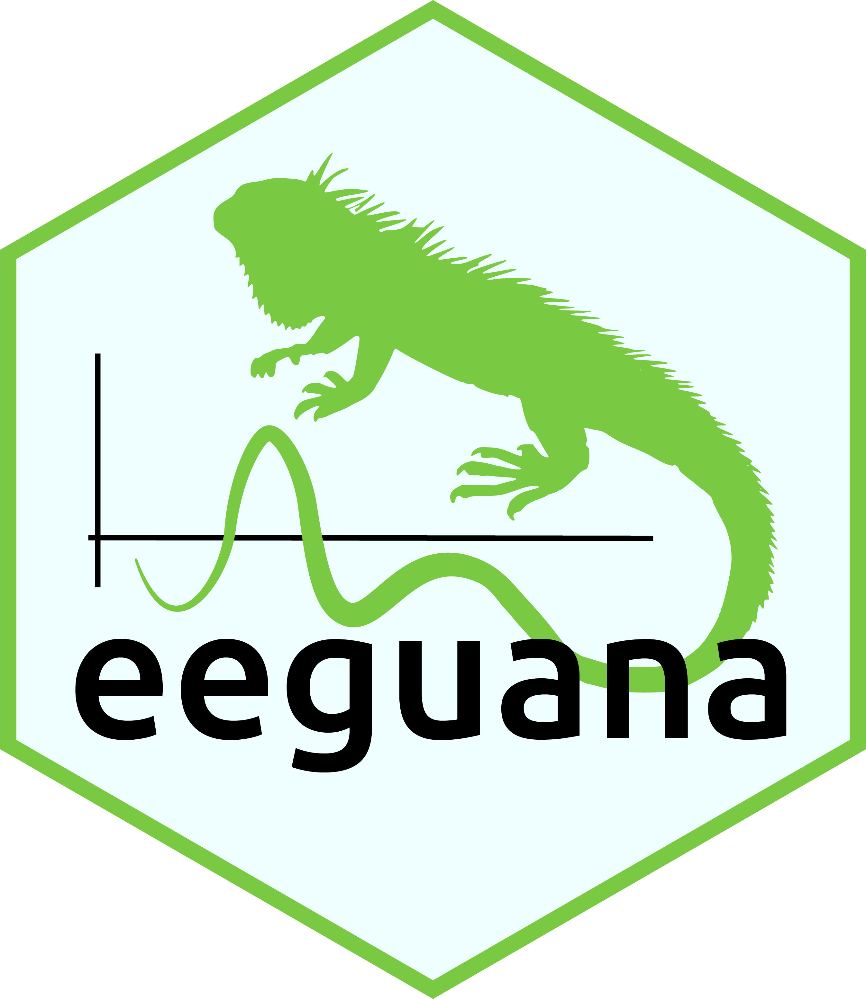
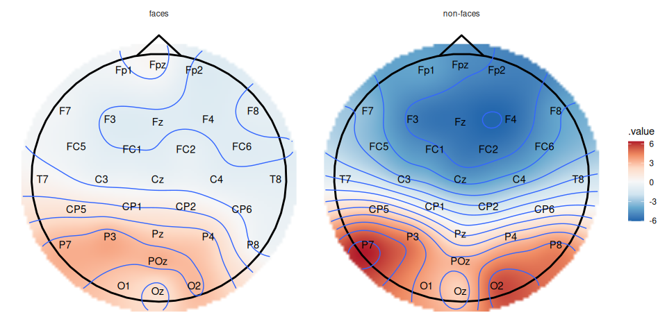
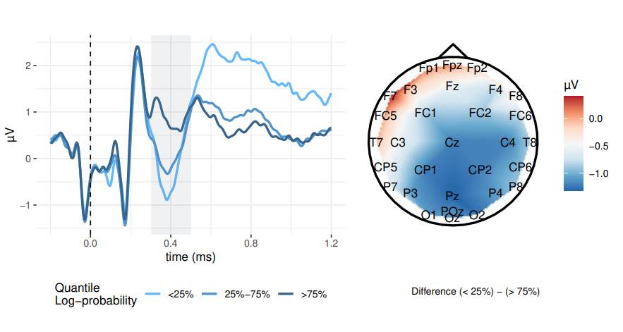

## What I work on

- **Computational models of reading**
- **EEG in psycholinguistics**: constraint, predictability, and semantic association
- **Computational modeling** in a Bayesian statistics framework for cognitive science
- **R software**:
  - **eeguana**: tidy EEG processing
  - **pangoling**: word probabilities from language models

## eeguana: tidy EEG processing in R {.title-logo} {.smaller}

```{.r code-line-numbers="false"}
library(eeguana)
faces <- read_vhdr("faces.vhdr")

faces |>
  eeg_segment(.description %in% c("s70", "s71"), .lim = c(-.2, .25)) |>
  eeg_baseline() |>
  eeg_mutate(condition = ifelse(description == "s70", "faces", "non-faces")) |>
  eeg_filter(between(as_time(.sample, .unit = "ms"), 100, 200)) |>
  eeg_group_by(condition) |>
  eeg_summarize(across_ch(mean)) |>
  plot_topo() + annotate_head() + facet_grid(~condition)
```

{.nostretch width="55%" fig-align="center"}

## The TiNT corpus {.smaller}

:::: {.columns}
::: {.column width="40%"}
- **T**ilburg corpus of **N**atural Dutch **T**exts
- **71** native Dutch speakers
- **8** natural texts of about 600 words each
- **EEG** and **self-paced reading** recorded together, word by word
- Classic effects replicate: N400, P600, and surprisal in reading times
:::
::: {.column width="60%"}

:::
::::

::: {.ref}
Østergaard, Lichtenberg, Boon, & Nicenboim (2025), [PsyArXiv](https://osf.io/preprints/psyarxiv/g32rp_v2)<br>
Data: [DataverseNL, doi:10.34894/0O5XQ7](https://dataverse.nl/dataset.xhtml?persistentId=doi:10.34894/0O5XQ7)
:::

## What we are doing with it

**Right now**

- Using **embeddings from language models** to operationalize semantic association between words
- Modeling **EEG and reading times together**

**Later**

- Potentially as a test bed for computational models of reading
